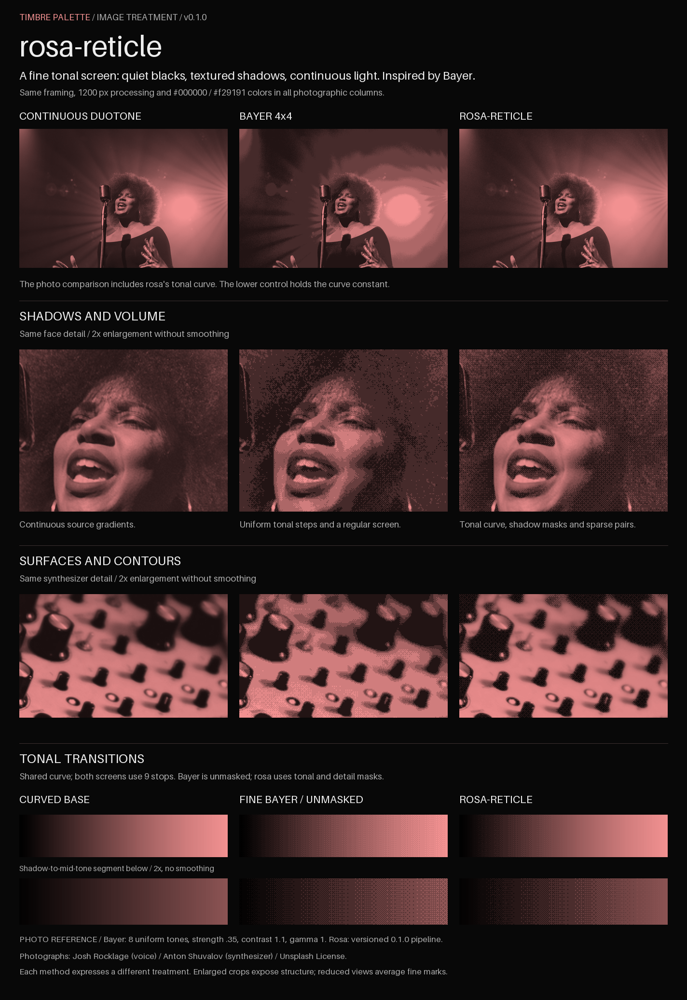

# rosa-reticle 0.1.0

rosa-reticle is a **Bayer-inspired tonal dithering pipeline** for photographs
and video. It places a fine, deterministic screen in shadow transitions while
preserving continuous gradients in illuminated areas. Sparse horizontal and
vertical point pairs give the screen its own rhythm without introducing
characters or large photographic cells.

Images are rendered offline. PNGs include the duotone colors; videos transport
the treated grayscale image and receive their duotone at display time.

## Visual showcase



The photographic columns share framing, processing width and duotone colors.
The Bayer reference uses eight uniform grayscale tones, strength .35, contrast
1.1 and gamma 1. The rosa-reticle column uses the complete 0.1.0 pipeline,
including its tonal curve. Differences in photographic volume therefore
reflect the complete treatment, not screen geometry alone.

The lower control shares the rosa tonal curve and uses its nine-stop palette
for both screens. The fine Bayer control is unmasked; rosa-reticle applies its
tonal/detail masks and sparse pairs. Enlarged crops use nearest-neighbor
sampling to expose the actual marks. Inspect the full-size PNG when judging
the one-pixel texture; documentation viewers may resize it.

Regenerate the showcase from the local source photographs:

```sh
python3 scripts/rosa_reticle_showcase.py --force
```

The script writes `docs/images/rosa-reticle-showcase.png` and an adjacent
JSON manifest with source/engine hashes, credits, crop coordinates and exact
comparison settings. Use `--output <path.png>` for another destination or
`--assets-dir <directory>` for the source folder. Existing outputs require
`--force`. It uses Pillow's bundled font and includes no timestamps, so the
same sources, implementation and Python/Pillow versions produce identical
artifacts. Photography credits and licensing remain in the image catalog;
the showcase reproduces these credits in its JSON sidecar.

## Requirements

Run commands from the repository root with Python 3.10+ and Pillow:

```sh
python3 -m pip install 'Pillow>=10.1,<13'
```

Video export also requires FFmpeg with `libsvtav1` for AV1 or `libvpx-vp9` for
VP9. Source media must be available locally and appropriately licensed.

## Treat a photograph

```sh
python3 scripts/treat_instrument.py assets/piano.jpeg /tmp/piano-rosa.png
python3 scripts/treat_instrument.py assets/piano.jpeg /tmp/piano-blue.png \
  --width 1200 --shadow '#000000' --highlight '#9EBBD1'
```

The equivalent engine entry point is:

```sh
python3 scripts/rosa_reticle.py image assets/piano.jpeg /tmp/piano-rosa.png
python3 scripts/rosa_reticle.py --version
```

The exporter applies EXIF orientation, composites transparency over black,
resizes without upscaling, calculates the tonal screen, and maps the grayscale
to the selected colors. It writes an opaque RGB PNG without source metadata.
Output paths must be new and distinct from the input. Each image receives a
JSON sidecar (for example, `/tmp/piano-rosa.json`) describing its generation.

| Option | Default | Purpose |
| --- | --- | --- |
| `--width` | `1200` | Maximum image width in pixels. |
| `--shadow` | `#000000` | Opaque sRGB color at grayscale zero. |
| `--highlight` | `#f29191` | Opaque sRGB color at grayscale 255. |

The curve, tonal intervals, one-pixel screen scale and blending masks are
versioned parameters, rather than per-image styling options.

## Export video

Prepare treated frames once, then encode the delivery formats:

```sh
python3 scripts/rosa_reticle.py video assets/vinil.mp4 /tmp/vinil-rosa-av1.webm \
  --work-dir /tmp/vinil-rosa-frames --prepare-only

python3 scripts/rosa_reticle.py video assets/vinil.mp4 /tmp/vinil-rosa-av1.webm \
  --work-dir /tmp/vinil-rosa-frames --encode-only --preset av1

python3 scripts/rosa_reticle.py video assets/vinil.mp4 /tmp/vinil-rosa-vp9.webm \
  --work-dir /tmp/vinil-rosa-frames --encode-only --preset vp9
```

Omit the phase flags to prepare and encode in one invocation. Preparation
requires a new work directory. To resume interrupted frame treatment, use
`--prepare-only --resume-preparation` with the same source and work directory.
Completed PNGs are verified before reuse. An interrupted initial decode
requires a new work directory. Source hash and algorithm version are checked
when resuming or encoding.

The video exporter defaults to a maximum width of 1200 px (`--width`) and a constant output
cadence of **24000/1001 fps**. Inputs are converted to that cadence. It processes
the entire video, removes audio, and adds black padding on the right/bottom
when even dimensions are needed. Screen coordinates stay fixed between frames;
the treatment does not calculate motion vectors or normalize each frame's
histogram. Changes in source luminance can still change which marks appear.

For full-viewport delivery, prepare desktop and portrait-mobile frames separately:

```sh
python3 scripts/rosa_reticle.py video assets/vinil.mp4 /tmp/vinil-desktop-av1.webm \
  --work-dir /tmp/vinil-desktop-frames --width 1920 --prepare-only
python3 scripts/rosa_reticle.py video assets/vinil.mp4 /tmp/vinil-mobile-av1.webm \
  --work-dir /tmp/vinil-mobile-frames --width 608 --aspect 9:16 --focus-x .64 --prepare-only
```

`--aspect W:H` crops before treatment; `--focus-x` chooses the horizontal crop
center as a fraction of source width (default .5). Crop dimensions round to
even pixels. Width remains a maximum, so source pixels are never upscaled.
For the 1920×1080 vinyl source, these settings produce 1920×1080 desktop and
608×1080 portrait frames. The portrait framing retains the disc and stylus.

`--batch-size N` caps newly treated frames per run. Repeat the same preparation
command with `--resume-preparation` until all frames are ready. For long
encodes, `--chunk-frames N` caches separately encoded groups. Use `--max-chunks N`
to cap new groups per invocation, then repeat `--encode-only`. Completed groups
are checked by their frame counts and hashes; final assembly remuxes them
without another lossy encode. Keep the same framing and chunk settings when
resuming. Each independent group introduces a new prediction boundary.

`--encoder-speed` can override the AV1 preset (0–13) or VP9 `cpu-used` (0–8)
without changing the tonal treatment. Higher values favor encoding speed and
may change compression efficiency. The actual arguments are recorded in each
video's JSON sidecar. Review decoded texture when choosing a delivery preset.

| Preset | Encoding |
| --- | --- |
| `av1` (default) | SVT-AV1, CRF 24, preset 6, YUV 4:2:0. |
| `vp9` | VP9, CRF 26, good mode, cpu-used 4, YUV 4:2:0. |

`--workers` controls frame-treatment processes (default 1). Higher values
require more CPU and permission to start local worker processes. This changes
processing speed, not pixel output. Encoders use two threads. The work directory
retains decoded source frames and treated PNGs so another format can be encoded
without recalculating the screen; delete it when no longer needed.

Each video gets a JSON sidecar with `algorithm_version`, source SHA-256, frame
count, frame rate, framing/dimensions, tonal parameters, exact rank matrix,
encoder arguments, output hash and poster hashes. The exporter also copies
grayscale and duotone PNG posters alongside the video. AV1/VP9 outputs sharing
the same basename (apart from `-av1` / `-vp9`) share these poster files.
Existing video and sidecar paths are preserved.

## Display the duotone

The exported video is intentionally grayscale. Restore its colors with an SVG
filter operating in **sRGB**. The screen is already baked into the video;
there is no browser-side dithering or per-frame canvas processing.

```html
<svg width="0" height="0" aria-hidden="true"
     style="position:absolute;overflow:hidden">
  <defs>
    <filter id="rosa-duotone" color-interpolation-filters="sRGB">
      <feColorMatrix color-interpolation-filters="sRGB" type="matrix" values="
        0.9490196078 0 0 0 0
        0.5686274510 0 0 0 0
        0.5686274510 0 0 0 0
        0 0 0 1 0" />
    </filter>
  </defs>
</svg>

<video controls muted playsinline loop preload="none"
       poster="vinil-rosa-poster-gray.png"
       style="filter:url(#rosa-duotone);max-width:100%;height:auto">
  <source src="vinil-rosa-av1.webm" type='video/webm; codecs="av01.0.05M.08"'>
  <source src="vinil-rosa-vp9.webm" type='video/webm; codecs="vp9"'>
</video>
```

Use the exported `*-poster-gray.png` as the filtered video's poster.
The filter also affects the poster, so a pink poster would be colored twice.
`poster.png` in the work directory is already pink and can be used as an
unfiltered static image instead.

For a different palette, each matrix row computes
`channel = gray × (highlight - shadow) / 255 + shadow / 255` using endpoint
channel values from 0 to 255. The example maps black to `#000000` and white to
`#f29191`. Keep `color-interpolation-filters="sRGB"`; SVG filters otherwise
operate in linearRGB. See [SVG filter color space](https://developer.mozilla.org/en-US/docs/Web/SVG/Reference/Attribute/color-interpolation-filters).

Supply a static fallback and playback controls for background use, respecting
reduced-motion preferences. Validate decode support, display filtering and
performance on target devices; file size alone does not establish playback
performance. Downscaling the one-pixel screen can reduce its visible contrast.

## Python API

```python
from PIL import Image
from scripts.rosa_reticle import __version__, treat_gray, duotone

with Image.open("assets/piano.jpeg") as source:
    gray = treat_gray(source, width=1200)

gray.save("/tmp/piano-gray.png")
duotone(gray, highlight="#f29191").save("/tmp/piano-rosa.png")
```

`treat_gray` returns an `L` image. `duotone` returns an `RGB` image and accepts
opaque `shadow` and `highlight` colors. Treat a complete frame before cropping:
the detail-protection mask uses neighboring pixels. Identical inputs and
parameters produce identical results with the same Python/Pillow versions.

## Batch manifests

`prepare_images.py` selects the renderer from the manifest's
`treatment_version`. For rosa-reticle, use:

```json
{
  "schema_version": 1,
  "treatment_version": "rosa-reticle-0.1.0",
  "defaults": {
    "width": 1200,
    "shadow": "#000000",
    "highlight": "#f29191"
  },
  "images": []
}
```

Populate `images` with the repository's image-manifest records. Defaults,
family tones and per-image options are combined in that order. Only `width`,
`shadow` and `highlight` are image-treatment options. Migrate the manifest
version/options and its generated assets together.

The repository catalog and single-image exporter use rosa-reticle 0.1.0.

## Generation records

The input catalog declares the requested treatment. The output generation
manifest records what actually happened to each image. Every batch writes
`assets/treated/manifest.json`; choose another location with
`--generation-manifest <path.json>`.

Each generated record includes:

- Asset slug, family, and family color endpoints.
- Source path, SHA-256, byte size, original dimensions, format and mode.
- Output path, SHA-256, byte size, dimensions, format and mode.
- UTC generation time and treatment version.
- Effective options after resolving defaults, family tones and image overrides.
- Tonal curve, grayscale palette and exact screen ranks.
- Renderer/engine source-file hashes, Python/Pillow versions and PNG settings.

The batch log also fingerprints its input catalog and generator script, records
start/end times and counts, and distinguishes generated, skipped and pending
entries. Updates use atomic replacement; a failed batch retains completed
records and reports `status: failed`.

When an output is skipped, its original generation time and provenance are
retained only if the recorded output hash still matches the file. The
`matches_current_request` field reports whether the source, recipe and family
settings still agree with the catalog. A mismatch records the new request
separately; it does not claim the old file was regenerated. Outputs lacking
verified provenance are marked `provenance: unknown`. Regenerate with `--force`
to establish a new recorded generation.

The single-image CLI writes the same generation fields into an adjacent JSON
sidecar. Calls to the in-memory Python image API do not write files or logs.
Paths are recorded as declared in the input catalog or CLI arguments.

## Implementation and contribution checks

The engine uses a continuous tonal curve and a nonuniform grayscale palette.
A Bayer 4×4 scaffold distributes quantization error. A fixed 16×16 ranked
screen introduces sparse pair arrangements in emerging shadows, blended with
the fine screen according to tone. Deep blacks and illuminated regions remain
continuous. The screen is periodic and deterministic; it is not random noise.

| File | Responsibility |
| --- | --- |
| `scripts/rosa_reticle.py` | Versioned image engine and CLI entry point. |
| `scripts/treat_instrument.py` | Instrument PNG exporter using the engine. |
| `scripts/rosa_gray_video.py` | Resumable grayscale-frame preparation and video export. |
| `scripts/rosa_video_presets.py` | Delivery encoder settings. |
| `scripts/rosa_reticle_showcase.py` | Documentation comparison image and reproducible showcase metadata. |
| `scripts/image_provenance.py` | Generation-record schema, fingerprints and atomic JSON writes. |
| `tests/test_rosa_reticle.py` | Current tonal, geometry and image API contracts. |

Run the focused suite before submitting changes:

```sh
python3 -m unittest discover -s tests -p test_rosa_reticle.py
python3 -m unittest discover -s tests -p test_image_provenance.py
```

Check tonal coverage, shadow texture, endpoint colors, coordinate stability,
transparency and reproducibility. Review photographs at native size and at the
intended display size, then review decoded video in motion. Changes to the
curve, palette, screen geometry or blending masks change the visual treatment
and require an algorithm-version update. Encoder-only changes belong in the
preset/sidecar metadata.
